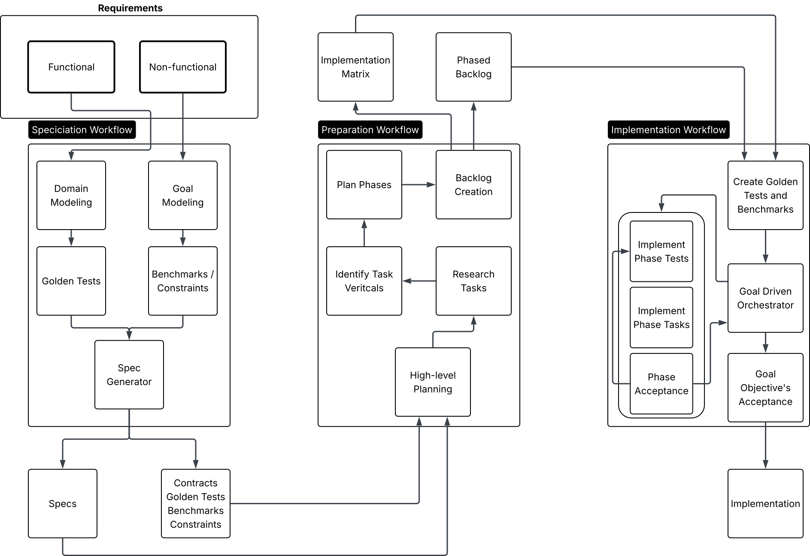

# RDD harness

A repository-local **Requirements Driven Development (RDD)** harness for Codex. It turns formal requirements into a frozen solution, a scoped implementation plan, and a verified stack of phase pull requests, with evidence connecting the result back to the original requirements.

This repository includes the canonical [Rust Todo requirements](requirements/requirements.md), with developer-authorized amendments recorded in their revision history. The Todo application has **not been implemented**. The harness supplies the controller, agent skills, artifact schemas, contract generator, CI, and regression tests needed to develop it through the workflows below.

[Understand the workflow](#how-the-workflow-fits-together) · [Prerequisites](#prerequisites) · [Get started](#get-started) · [Recovery](#follow-progress-and-recover) · [Completion](#what-counts-as-complete) · [Guides](#important-files-and-guides)

## What is RDD?

RDD keeps product obligations connected to design decisions, implementation work, and measured results. Functional requirements describe what the application must do. Quality constraints describe properties such as reliability, performance, privacy, and accessibility. Both become explicit solution specifications, contracts, scenarios, and verification checks before application implementation begins.

The traceability chain is:

**Requirement ↔ subdomain/behavior ↔ scenario/check ↔ groomed task/work sites ↔ phase evidence and PR ↔ project validation**

A scenario describes the behavior or constraint to prove; a check supplies its executable test or evidence protocol. Tasks identify the exact work and allowed files. Phase review establishes whether that work satisfies the obligations being accepted. Final project validation combines the results across the whole application. A completed checklist or a model's success message cannot replace this evidence.

## How the workflow fits together



[Open the full RDD diagram](docs/harness/rdd-diagram.svg).

The diagram is conceptual; the controller and frozen artifacts define the operational rules. Its labels are outlined graphics, so the walkthrough below also describes the flow in text.

1. **Specification** derives every functional subdomain and behavior, the complete target folder system, contracts, golden scenarios and quality protocols. Research and real qualification establish execution feasibility. Two independent perspectives—semantic coverage and execution readiness—must approve the same candidate with zero unresolved findings before freeze.
2. **Preparation** fully grooms every task, producer/input dependency, phase, category, vertical and work site within the frozen solution. It creates safe comment-only shells, full primary task packets, linked local packets and the matrix. Materialization enters `preparing`; actual readiness/CI evidence and final two-perspective review must pass `gate preparation` before implementation.
3. **Implementation** works through the phased backlog. Tests and benchmarks are implemented according to the scoped phase tasks, followed by production changes, independent review, and acceptance checks. Each accepted phase gets a PR and seal; the project gate evaluates the final result.

| Stage | Input | Accepted output |
| --- | --- | --- |
| Specification | Canonical requirements and relevant existing code | Frozen solution and target-folder design, complete behavior/golden coverage, qualified contracts, execution prerequisites and two independent reviews |
| Preparation | Frozen solution and contracts | Fully hydrated backlog, producer closure, exact co-located work sites, phase/category/vertical projections, matrix and exact-source preparation gate |
| Implementation | Committed and pushed prepared baseline | Tested application changes, revision-bound evidence and independent reviews, one verified PR per phase, phase seals, and project validation |

**Frozen artifacts** are approved files whose exact identities are recorded by the controller. Downstream work must preserve that authority; changing a contract or acceptance meaning requires a new specification run. Generated Rust messages and local unary service traits enforce interface shapes, while application checks must also prove that real providers and consumers use those boundaries. The seed contract in this boilerplate qualifies the generator; it is not the Todo domain model or a requirement to add a network server.

A **vertical** is an ordered chain of dependent tasks toward a capability. A **phase** is a dependency-closed group of tasks: its accepted obligations may depend on earlier phases, but never on unfinished future work. An **acceptance gate** checks whether the current source, results, and review permit phase closure or project completion. See the [workflow guide](docs/harness/workflow-guide.md) for the detailed transitions.

## What the harness controls

Agents interpret requirements, research dependencies, author specifications and code, and review whether the result fulfills the intended behavior. The deterministic Python controller validates artifact structure, traceability, dependency order, task ownership, source identity, evidence, and state transitions. Structural validation supports semantic review; it cannot establish correctness by itself.

Named specialists own domain analysis, verification design, contract architecture, qualification and task planning. The [runtime roster](docs/harness/codex-runtime.md#runtime-contract) defines their assignments and models. `rdd_complex_implementor` handles large or small tasks; `rdd_light_implementor` handles small, unambiguous tasks. At most **two authors** run concurrently alongside a read-only live reviewer. Final independent review binds the exact candidate.

Workers receive bounded task packets and isolated Git worktrees with disjoint write scopes. The controller integrates committed work only from the leased base and declared files. Requirements, frozen artifacts, generated contracts, controller policy, skills, and CI cannot be rewritten by implementation tasks to weaken their own acceptance rules.

Within each phase, tasks follow this order:

**Tests → deletion → modification → addition → documentation**

Tests must first reach an actual failing behavioral assertion (RED). Missing tools, compiler errors, and skipped tests are not RED. Test-only scaffolding may make the assertion executable, but cannot supply product behavior. Additions need a frozen reuse analysis explaining why existing code cannot reasonably provide the capability.

Task markers such as `RDD:P01:tests:V01+V03:T001:A01` encode phase, classification, sorted verticals, task and work site. A full packet is co-located at the primary work site; secondary sites have local instructions and a primary reference. Noncommentable and deletion targets use adjacent sidecars. The plan and transactional state remain authoritative. Use controller commands to complete tasks and reconcile markers; never edit SQLite state, locks, receipts, or unfinished markers to force progress. Implementation review gates occur at phase completion, rather than after each task. Specification and preparation have their own two-perspective exit reviews. Frozen specification/planning defects discovered downstream are critical harness regressions: preserve evidence, repair the missing prevention and add a regression before a fresh trial.

## Prerequisites

The controller uses the Python standard library; no Python package installation is needed. Python and Git are enough for initialization and offline harness tests. The full workflows also need the tools and access below.

| Prerequisite | Purpose |
| --- | --- |
| Python 3.11+ and Git | Controller, regression suite, exact source identities, branches, and isolated worktrees |
| Codex CLI with native Goals and custom subagents | Interactive workflows and configured agent roles |
| Model/account access | The Astra/ultra, Sol/xhigh, and Luna/xhigh settings listed above; no silent model downgrade |
| GitHub CLI `gh` and a writable GitHub `origin` remote | Phase PR publication, required checks, and stack verification |
| Rustup with the [pinned Rust toolchain](rust-toolchain.toml) | Rust compiler, `rustfmt`, `clippy`, and `wasm32-unknown-unknown` for native and Rust/WASM work |
| Buf CLI | Protobuf linting, descriptors, and contract verification |
| Native Tauri development tools for each required OS | Actual desktop build, integration, and packaging qualification |

Authenticate Codex and GitHub locally before starting development, and configure your own Git author identity. `doctor --full` inspects tool availability, client capabilities, and authentication. Advertised model support **does not prove account entitlement**: the doctor always reports `account_access_verified=false` because it performs no paid model invocation. Actual access is established when the model is used. Missing tools or model access are blockers, not permission to substitute a different configuration.

The [runtime guide](docs/harness/codex-runtime.md) links installation references and explains the pinned CI tools. Specification selects and qualifies the application dependency versions, Rust UI framework, build tools, and platform testing route. Protoc is optional for the shipped generator because Buf emits descriptors that Prost can consume directly. Reference-device benchmarks and manual accessibility checks still require the actual specified environments; ordinary hosted CI does not replace them.

## Get started

### Initialize and inspect without starting development

Clone your repository or fork using its actual URL, then initialize local state:

```sh
git clone YOUR_GITHUB_REPOSITORY_URL rdd-harness
cd rdd-harness
git switch -c codex/todo-baseline origin/main
./rdd init
./rdd status
./rdd --help
./rdd selftest
./rdd doctor --full
```

Run `init` before `status` on a fresh clone: Git does not carry the ignored local run locator. These commands initialize or inspect the harness and run its isolated regression fixtures; **they do not start an RDD development run**.

| Command | Purpose and expected result |
| --- | --- |
| `./rdd init` | Creates local directories and the run locator; reports `status: initialized` |
| `./rdd status` | Reports authoritative state and source identity; a fresh harness remains `not_started` with no active run |
| `./rdd --help` | Lists controller commands; use a subcommand's `--help` for its arguments |
| `./rdd selftest` | Runs offline controller/adapter regressions, including real subprocess and Git fixtures; success is harness verification, not Todo acceptance |
| `./rdd doctor --full` | Reports tools, authentication, and advertised client capabilities; resolve reported blockers before workflow execution |

On Windows, replace `./rdd` with `python tools/rdd/cli.py`, `rdd.cmd` in Command Prompt, or `./rdd.ps1` in PowerShell, keeping the same arguments. On Unix, `python3 tools/rdd/cli.py` also works if a file extractor did not preserve executable permissions.

`./rdd selftest --suite portability` runs the focused process, Git, encoding and storage checks used by routine native CI. The default remains the full suite. Add `--timings .rdd/evidence/selftest-timings.json` to either suite to record individual test outcomes and elapsed times.

If starting from an archive rather than a clone, extract it into its own directory, initialize Git on a named authoring branch with `git init -b codex/todo-baseline`, and run `./rdd init` there. After configuring your Git identity, make the initial source commit and connect a writable `origin` remote if one does not already exist. Clones already have history and a remote; they do not need an extra initialization commit.

To inspect the specification launch prompt without opening Codex or starting a run:

```sh
./rdd workflow specification --print
```

Use that command **without `--mode`**. Supplying an explicit mode can start a new run and archive prior artifacts even when `--print` is present.

### Start development deliberately

`main` is the merge-only release branch. Begin on a clean, dedicated baseline such as `codex/todo-baseline`; use that branch for all specification and preparation commits. In the examples below, replace `YOUR_BASELINE_BRANCH` with its actual name. Phase PRs targeting `codex/*-baseline` or `rdd/**` receive trusted CI; baseline pushes do not start jobs. Dispatch preparation qualification explicitly when its committed materialization is ready. Other naming patterns require a reviewed CI filter change before specification freeze. The controller rejects source authoring on `main`, detached HEAD, or a branch other than the recorded baseline/phase. Complete each workflow and commit its accepted output before continuing; these are separate interactive sessions, not a batch script.

1. **Specify the solution.** For a first full solution, start a regenerate run:

   ```sh
   ./rdd workflow specification --mode regenerate
   ```

   Resolve architectural questions in the Codex session. The workflow qualifies the solution and freezes the specification and contracts. Commit the accepted baseline before preparation.

2. **Prepare the work.** From the frozen specification:

   ```sh
   ./rdd workflow preparation
   ```

   The workflow reviews and freezes the task graph, then materializes the approved shells, task packets, and matrix. This enters `preparing`; commit the materialized handoff before final review. A frozen specification defect stops affected work and is recorded as a critical harness regression.

3. **Publish and accept preparation.** Push the committed materialization outside `main`:

   ```sh
   git push origin YOUR_BASELINE_BRANCH
   gh workflow run preparation.yml --ref YOUR_BASELINE_BRANCH -f candidate=FULL_MATERIALIZATION_SHA
   ```

   Replace `FULL_MATERIALIZATION_SHA` with the full committed SHA from `git rev-parse HEAD`; the dispatched baseline ref must resolve to that exact revision. Obtain successful preparation CI using the pinned `RDD_PREPARATION_HARNESS_SHA`, import any required external evidence, and run `./rdd readiness preparation`. Both independent final reviewers must inspect the committed handoff and current evidence; record their reports, then run `./rdd gate preparation`. Only a passing gate grants `prepared` and permits P01. See the [preparation protocol](docs/harness/workflow-guide.md#stage-two-preparation) for the exact sequence.

   The first phase PR uses this accepted remote baseline. Require `verify` on it; later phase bases need the same required check only after they are sealed. Do not protect active phase heads with a blanket status-check rule. See the [manual demo runbook](docs/harness/blog-demo.md#5-publish-and-verify-the-dedicated-prepared-baseline) for setup commands.

4. **Open implementation and activate native Goal mode.** Obtain the objective, then launch the implementation session:

   ```sh
   ./rdd goal
   ./rdd workflow implementation
   ```

   In Codex, submit `/goal` followed by the exact objective printed by `./rdd goal`. The launcher provides the handoff; it does not activate native Goal mode itself. The objective is under 4,000 characters. Follow the [official Goals guide](https://developers.openai.com/cookbook/examples/codex/using_goals_in_codex) for the Goal lifecycle and the [workflow guide](docs/harness/workflow-guide.md#stage-three-implementation) for controller operations.

For full access without command-approval prompts, add `--permission=full-access` to each interactive launch:

```sh
./rdd workflow specification --mode regenerate --permission=full-access
./rdd workflow preparation --permission=full-access
./rdd workflow implementation --permission=full-access
```

Run these separately as each stage becomes ready. The option passes `--sandbox danger-full-access --ask-for-approval never` to Codex for that session. Omitting it keeps the coordinator's configured sandbox and the runtime's approval policy. `./rdd goal` only prints the objective; submit it with `/goal` inside the implementation session to use that session's permissions. See [workflow permissions](docs/harness/codex-runtime.md#workflow-permissions) for launch inspection and recovery.

## Follow progress and recover

Use `./rdd status` for the current run, active phase, tasks, blockers, and exact source identity. During an active run, preserve a checkpoint before moving or discarding the checkout:

```sh
./rdd export-run .rdd/evidence/run-checkpoint.json
```

After resolving an interruption, return to the run's recorded baseline or phase branch and resume local controller state with:

```sh
./rdd resume
```

Worker branches and worktrees survive release and lease expiry. Interrupted integration is reconciled against the submitted commit; unresolved cherry-pick conflicts require deliberate resolution or abort before resume. An environment or review blocker can resume after its cause is fixed. Authority, planning, sealed-phase, and exhausted-budget blockers require a new specification run.

To restore on another machine, transfer the Git repository at the checkpoint's exact revision and source contents plus the exported checkpoint. Preserve outstanding worker branches separately, then run:

```sh
./rdd resume --from PATH_TO_RUN_CHECKPOINT.json
```

Runtime state and evidence are ignored by Git, so pushing source alone does not transfer them. The checkpoint carries run state and raw check logs; imports verify source/lock identity and log hashes. See [recovery procedures](docs/harness/workflow-guide.md#repairs-and-interruptions) and the [evidence guide](docs/harness/evidence-guide.md) for the full process.

An older run whose baseline was recorded as `main` remains inspectable/exportable. Preserve its source and checkpoint, then start a fresh run on a dedicated baseline; do not edit recorded branch identities to move it. Branch refusals preserve dirty work and do not automatically switch, stash, reset, or rewrite artifacts.

For a bounded change to requirements or a sealed design/implementation defect, use `./rdd workflow specification --mode amend` from the selected baseline, then repeat preparation and implementation. Commit any authorized requirements edits first. The amendment must record impact and preserve unaffected work and history. Use `--mode regenerate` for a fresh full solution: it archives prior active artifacts, but replacement of existing application code remains explicit planned work. A repair within an open phase can use existing scoped tasks; a sealed phase cannot be reopened. See [amendment and regeneration](docs/harness/workflow-guide.md#amendment-and-regeneration).

## What counts as complete?

### Phase readiness and project acceptance

A phase closes only when its committed source has completed tasks, reconciled markers, passing cumulative checks, required native/manual evidence, and an independent review of that exact revision. The coordinator gates the phase, publishes its PR, verifies the stack, and seals it. The first PR targets the preparation baseline branch; each later PR targets its preceding sealed phase branch.

The default PR completion policy is **ready**: open, non-draft, reviewed, and passing required checks at the accepted head. GitHub changes requests veto readiness; additional human approval can be configured before specification freeze. Keep the stack unmerged while the run is active. The controller does not force-push or silently restack sealed phases.

Only `./rdd gate project` returning **`status: passed` and `application_complete: true`** establishes application completion. It requires all canonical tasks done, no remaining task markers, every phase sealed, the stack currently verified, and all required cumulative/project tests, benchmarks, and platform/observer evidence. It writes:

- `.rdd/evidence/project-validation.json`: source identities, requirement coverage, checks, metrics, reviews, and PRs.
- `.rdd/evidence/project-validation.md`: readable acceptance report.
- `.rdd/evidence/completed-run.json`: portable checkpoint with run state and raw check logs.

A paused Goal, a worker's prose, or passing harness tests cannot establish project acceptance. PR merging and release publishing are separate developer actions after validation.

### Release into main

After project acceptance, archive the reports/checkpoint and keep the phase stack intact. Create one `codex/rdd-release/<run-id>` branch at the accepted application commit and open a PR into `main`. The operator sets `RDD_RELEASE_POLICY_SHA` to the first phase's recorded prepared-base commit and `RDD_RELEASE_SOURCE_SHA` to the project-accepted head through repository Actions variables. Release CI requires both exact pins, uses the verifier from `main` with the separately pinned prepared policy, and rejects incomplete or changed source. Only merge after successful checks and normal review. No specification/preparation-only PR is needed on `main`. The [manual demo runbook](docs/harness/blog-demo.md#8-verify-and-merge-one-complete-release-pr-into-main) contains the full pin, publish, merge and launch commands.

### What CI proves

Routine harness PRs run the full candidate tests and real contract compiler proofs on Linux, the trusted base tests once on Linux, and focused portability tests on macOS and Windows. Documentation-only PRs and `main` pushes run lightweight Linux checks. Full native harness qualification runs on release PRs and by explicit dispatch. The PR aggregate **`verify`** requires every job selected for that run; an unexpected skip is a failure. See the [CI routing table](docs/harness/codex-runtime.md#ci-and-reference-platform-evidence).

A phase PR uses the trusted base controller and frozen policy on its declared hosted environments. The initial frozen specification/preparation baseline lives on its dedicated branch; an implementation PR cannot replace its own frozen policy. The release route uses operator-pinned policy while retaining the controller from the PR's `main` base. An ordinary unfrozen harness-maintenance PR into `main` has a separate test route and cannot certify application acceptance.

Preparation CI is dispatch-only while the run is `preparing`: pin the trusted harness in `RDD_PREPARATION_HARNESS_SHA`, push the materialized baseline and dispatch its exact SHA using that baseline ref. Successor dispatches on the same baseline cancel older attempts. Import raw evidence before `gate preparation`; hosted success cannot replace qualified-host/manual proof. See the [workflow guide](docs/harness/workflow-guide.md#stage-two-preparation).

Before a frozen application plan exists, the stateless `./rdd ci` verifier reports `harness_only` with `application_complete=false`. An intact prepared baseline verifies contracts and pending markers. A phase PR runs cumulative ordinary checks for the applicable native platform. Manual checks and reference-host benchmarks remain pending external evidence, required at the local phase/project gates.

On nonphase branches, the stateless verifier accepts only markers matching a complete phase prefix and selects cumulative checks through that boundary, including project checks at the final boundary. It reports `observed_through_phase`, using `source_cumulative` scope when phases have been completed in the source projection, or `release_source` for explicit release verification. `phase` remains `null`, and both `task_history_verified` and `application_complete` remain `false`. A separate trusted base prevents reduced coverage; lightweight post-merge diagnostics do not run this verification. Marker inference selects checks without proving task history, phase seals, reviews, or project acceptance.

Protect the verification workflow and policy through repository rules and review. The harness trusts its local controller and evidence observers; it is not a sandbox against someone who can rewrite the verifier or state. See the [security model](docs/harness/security-model.md) for the trust boundary and the [runtime guide](docs/harness/codex-runtime.md#ci-and-reference-platform-evidence) for CI and native evidence requirements.

## Important files and guides

| Path | What belongs here |
| --- | --- |
| [requirements/requirements.md](requirements/requirements.md) | Canonical product obligations |
| `docs/specs/`, `docs/decisions/`, `.rdd/spec.json` | Solution and decisions produced by specification |
| `contracts/`, `gen/` | Canonical Protobuf contracts and qualified generated outputs |
| `.rdd/plan/`, `.rdd/prepared.json` | Frozen tasks, verticals, phases, matrix, markers, and preparation receipt |
| `modules/`, `apps/`, `tests/`, `benchmarks/` | Future Rust Todo application and its verification; `tests/harness/` already tests the controller |
| `.rdd/run.json`, `.rdd/runtime/`, `.rdd/evidence/` | Ignored local run locator, transactional state, and verification results |
| `.rdd/baselines/` | Historical baseline artifact copies |
| [.agents/skills/](.agents/skills/README.md), [.codex/agents/](.codex/agents/) | Workflow/supporting skills and Codex roles |
| [tools/rdd/](tools/rdd/), [tools/proto-codegen/](tools/proto-codegen/) | Python controller and Rust contract generator |
| [.rdd/config.json](.rdd/config.json), [AGENTS.md](AGENTS.md) | Controller policy and repository authority rules |

For deeper work, use the existing guides:

- [Workflow guide](docs/harness/workflow-guide.md): stage procedures, task integration, review, repair, and recovery.
- [Manual blog demo](docs/harness/blog-demo.md): complete generation, progress, verification, release PR and packaged-app walkthrough.
- [Artifact guide](docs/harness/artifact-guide.md): manifests, schemas, frozen identities, and authoring boundaries.
- [Evidence guide](docs/harness/evidence-guide.md): real check receipts, native/manual imports, metrics, and provenance.
- [Codex runtime guide](docs/harness/codex-runtime.md): client setup, Goals, adapters, PR policy, and CI.
- [Security model](docs/harness/security-model.md): trusted components and limits of verification.
- [Skill guide](.agents/skills/README.md): the three primary workflows and supporting skills.

Adjust protected harness policy, tools, models, or skills through deliberate review before specification freeze, and run `./rdd selftest` after harness changes. During implementation, those frozen rules remain part of the acceptance authority.
