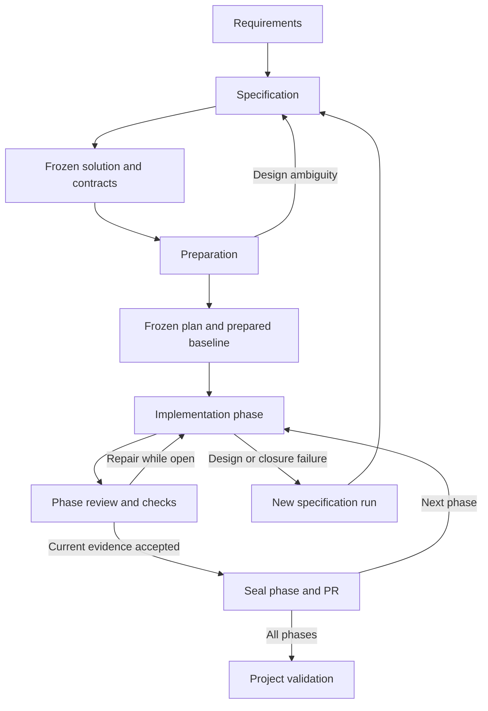

# The three RDD workflows

This repository implements the harness. The supplied Todo requirements are the first input; the application, its selected domain layout, and its task backlog are deliberately produced by the workflows. No application behavior is implied by empty navigational directories.

Read `README.md` for host installation and `codex-runtime.md` for the installed Codex runtime and model settings. The Python controller works independently of a model and owns durable state. Skills direct agent reasoning and work. A local agent still needs the selected language tools, platform dependencies, model access, and GitHub credentials for operations that require them.

## Authority and state

`requirements/requirements.md` defines the product obligations. `.rdd/spec.json` and its listed documents/decisions select the solution. Canonical contracts under `contracts/` and generated outputs under `gen/` are frozen with that solution. `.rdd/plan/plan.json` selects implementation work and phase order. Comments are generated task projections; `.rdd/runtime/` stores controller state. Evidence describes measured behavior and never overrides the requirements.

Use controller commands for transitions. Do not edit run state, SQLite rows, locks, seals, evidence receipts, or task markers to force progress. `./rdd status` and `./rdd --help` are the operational entry points. On Windows use the provided launcher described in the README with the same arguments.



Only specification resolves requirement and architectural ambiguity. Preparation can correct its own draft task graph before freezing. Implementation can repair work within the open phase's accepted scope. A changed contract, acceptance meaning, or previously sealed guarantee requires a new specification run.

## Stage one: specification

Start from a clean Git baseline as directed by the README. The controller records exact source identities, not a filename alone.

```bash
./rdd init
./rdd doctor
./rdd start --mode regenerate
./rdd requirements index
./rdd spec init
```

Ask Codex:

> Use $specification-workflow for the active regenerate run. Derive the complete solution from requirements/requirements.md, resolve architectural questions here, qualify the fixed Rust/Tauri/Turso stack, and freeze the specification only after independent review and reproducible contract compilation. Do not implement application behavior.

`./rdd workflow specification` provides the repository's stage prompt/instructions. Follow `codex-runtime.md` for invocation in the installed client. The interactive coordinator can use the configured researcher and reviewer roles for independent work. The skill describes the expected output; the controller validates machine structure and invariants.

The agent creates solution documents and decisions, a complete requirement map, scenario definitions and test oracles, benchmark protocols, module boundaries, dependency/version decisions, and the exact contract/generation set. It authors the machine manifest from the schema. Human-readable templates are in `.rdd/templates/`; they are not completed solution artifacts.

Compile the proposed canonical contracts and a generated-interface consumer before freezing. The manifest's `contract_check_ids` names the checks; `spec freeze` runs them and records the exact files. This contract experiment produces shape/configuration artifacts, not application behavior. Preparation later reproduces and verifies that same set.

Set up required protected policy/tooling assets at this stage: exact generator/toolchain configuration, the trusted check definitions, and necessary CI configuration. The implementation workflow cannot modify protected harness policy paths merely to make a check pass. Application test source and evaluators can be planned under their designated unprotected project test/tool paths, but their required meaning is frozen in scenario and check definitions.

```bash
./rdd spec validate
./rdd spec freeze
```

Commit the frozen specification baseline before moving to preparation. The controller's generated receipts identify the exact bytes; a normal Git commit preserves the source baseline for the next workflow.

Do not proceed if requirements are ambiguous, a required platform is unsupported, or the selected contracts cannot compile. Record evidence and the smallest unresolved decision. A draft label in the example requirements does not by itself mandate a separate approval round when the user has already directed the workflow to use that input.

## Stage two: preparation

```bash
./rdd plan init
```

Ask Codex:

> Use $preparation-workflow for the frozen solution. Inspect existing code for reuse, derive the target tree, complete task DAG and ordered verticals, and dependency-closed phases. Preserve tests, deletion, modification, addition, documentation order. Review the phase boundaries independently, freeze the plan, then prepare exact contracts, shells, task projections, and the implementation matrix.

The preparation agent identifies actual target files rather than assuming the boilerplate's directory names define the application architecture. Every task has a category, requirements, spec links, prerequisites, exact writes, checks, acceptance, scope, anchor, and reuse rationale when adding code. Each task belongs to a phase and at least one ordered vertical.

A phase is independent when its claims depend only on the baseline, earlier accepted phases, and its own work. It can depend on previous stacked PRs. For every prerequisite `u -> v`, require `phase(u) <= phase(v)`. In a same-phase edge, category rank must not decrease. A replacement adapter addition needed before a caller modification therefore cannot be scheduled after that modification in the same phase.

Resolve graph, coverage, ownership, category, shell, and phase-closure findings before freezing. If the plan exposes missing design semantics, stop and return to specification; do not encode the question as a task.

```bash
./rdd plan validate
./rdd plan freeze
./rdd prepare
./rdd anchors verify
```

`prepare` runs after plan freeze. It verifies the specification and compiled contracts, creates only approved shells, projects phase-prefixed markers, and writes the implementation matrix and preparation receipt. It does not implement application behavior. Commit the resulting prepared baseline before beginning implementation, using the normal Git workflow. No phase should inherit uncommitted preparation work.

Use sidecars for editable noncommentable files and deletion targets. Frozen contracts and generated interfaces are read/check inputs; a sidecar cannot make a protected path writable. Comment-only Rust shells may exist without being imported into a build graph. Do not create bogus JSON or manifests merely to reserve paths.

## Stage three: implementation

Read `codex-runtime.md`, then retrieve the objective:

```bash
./rdd goal
```

Use the printed objective with the installed client's native goal facility described in that guide. The objective is below 4,000 characters. The longer `implementation-workflow` skill supplies the procedure through normal skill loading, rather than expanding the goal into an objective file.

The configured allocation is `gpt-6-astra` with `ultra` for coordination, `gpt-6.1-sol` with `xhigh` for large implementation and independent review, and `gpt-6-luna` with `xhigh` for small targets. These are requested runtime choices, not a guarantee that every account/client supports them. The harness reports a capability blocker rather than silently substituting models.

The coordinator uses the ready queue and controller state:

```bash
./rdd phase begin P01
./rdd next
./rdd task claim T001 --worker rdd_large --worktree
```

Task IDs here illustrate syntax; use the IDs in the generated plan. Give workers bounded packets and disjoint write ownership. The independent reviewer observes diffs and evidence while work proceeds and sends course corrections to the coordinator. Its final acceptance review occurs at phase completion, not after every task.

For a test task, author and commit the planned assertions in the assigned worktree. Integrate that commit on the phase branch, then retain the expected failing result against the integrated candidate:

```bash
./rdd task integrate T001 --commit COMMIT_SHA
./rdd check CHECK_ID --expect fail --task T001
./rdd task complete T001 --evidence EVIDENCE_ID
```

A configured behavioral failure is RED. The failure pattern must match an actual assertion/panic diagnostic rather than a matching phrase printed from source code; for a Python fixture, `AssertionError: EXPECTED_ASSERTION` is stronger than the bare marker text. Missing executables, download failures, wrong test filters, and unrelated compiler errors are not behavioral RED. A compile scaffold can permit the assertion to run, but must not supply the behavior being tested. Do not substitute a mock for the only test of a required real persistence or transport boundary.

For a greenfield Rust application, the first `tests` tasks may create explicitly planned test/build infrastructure: fixture crates, a consumer of the already compiled generated interfaces, and the minimal buildable application entry scaffold required to exercise the real command boundary. Declare those paths in the test task. This infrastructure must contain no completed product behavior; it may expose typed explicit not-implemented boundary stubs that make the required behavioral assertion fail. Every tests task, including the initial scaffold task, still needs behavioral RED; there is no green-bootstrap or compile-failure exemption. The check must launch successfully and reach its assertion. Plan replacement of each stub in subsequent modification/addition tasks; stubs cannot satisfy product acceptance. Implement actual domain, persistence, UI, and command behavior in the subsequent production categories. Preparation remains empty/comment-only, and a missing executable never substitutes for behavioral RED. If a runnable boundary cannot be established under the frozen design, return to specification rather than relabel the failure.

Execute remaining tasks in category order: deletion, modification, addition, documentation. Integrate isolated worker commits with the controller, using actual IDs and commit hashes:

```bash
./rdd task integrate T002 --commit COMMIT_SHA
./rdd check CHECK_ID --expect pass --task T002
./rdd task complete T002
./rdd anchors reconcile
```

After each task completes, commit the controller's marker cleanup before the next claim or integration. `task complete` records state before removing its projection; a cleanup interruption can be reconciled safely. These small commits stay inside the phase's single PR. If a deletion already removed its inline marker and there is no cleanup diff, no empty commit is required.

Mechanical checks on claims, ownership, dependencies, and evidence are workflow controls; they are not task-level reviewer gates. The plan's declared test/check requirements still apply.

When the phase is complete, commit its concrete candidate, obtain independent review for that exact HEAD/source digest, and run the acceptance gate:

```bash
./rdd review record .rdd/runtime/phase-review.json
./rdd gate phase P01
./rdd stack publish P01
./rdd stack verify
./rdd phase seal P01
```

The GitHub adapter uses one stable PR identity per phase. The first PR targets the baseline integration branch; later PRs target their predecessor phase branch. Publication is idempotent reconciliation, not “create another PR on retry.” Required checks and review must correspond to the actual current head before sealing. A rebase or conflict resolution requires fresh revision-bound evidence. A default completed PR is open and ready, with the configured checks satisfied; it is not implicitly merged or deployed.

### Repairs and interruptions

For a fix inside the current open phase's accepted scope:

```bash
./rdd task reopen T002 --reason 'Repair the current phase within its frozen scope'
```

Reopen the related test task when a regression assertion is needed. Reopened tasks form a repair sweep with the same category order. Reopening invalidates gate/review evidence. It cannot add scope or modify a sealed phase.

For a worker failure, preserve its worktree and use the supported release/resume commands:

```bash
./rdd task release T002 --reason 'Worker stopped before completion'
./rdd resume
./rdd status
```

Use `./rdd block --kind KIND --reason TEXT` for specification, planning, environment, authorization, budget, review, or closure blockers. A missing required platform is incomplete evidence, not an automatic skip. A sealed-phase defect uses `closure` and requires an amendment. Do not silently repair it in a later phase.

After all phases:

```bash
./rdd gate project
```

Success requires complete task state and marker reconciliation, current required tests/benchmarks/platform evidence, preserved contracts/spec/plan, completed phase PR policy, accepted independent reviews, and the generated project validation artifact. The evidence directory is ignored by Git to avoid a report changing the revision it claims to test; export or archive the resulting evidence according to the README after completion.

## Amendment and regeneration

Use `./rdd start --mode amend` after requirements change or an accepted design/implementation claim is invalidated. The amendment analysis includes shared vocabulary and NFR changes, reverse callers, contracts, migrations, tests, and benchmark fixtures. Preserve valid artifacts and prior history; create a new solution/plan/phase stack from the selected accepted baseline.

Use `regenerate` for a fresh full solution. The controller archives superseded active artifacts; application replacement is still explicit planned work. Neither mode authorizes deleting user data, rewriting sealed evidence, or bypassing tests.

The supplied requirements remain the example product source. The three workflows choose and develop its solution. Harness self-tests demonstrate controller behavior and do not constitute acceptance of the future Todo application.
