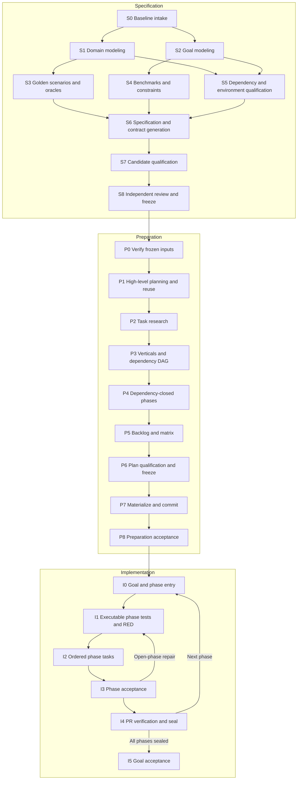

# The three RDD workflows

This repository implements the harness. The supplied Todo requirements are the first input; the application, its selected domain layout, and its task backlog are deliberately produced by the workflows. No application behavior is implied by empty navigational directories.

Read `README.md` for host installation and `codex-runtime.md` for the installed Codex runtime and model settings. The Python controller works independently of a model and owns durable state. Skills direct agent reasoning and work. A local agent still needs the selected language tools, platform dependencies, model access, and GitHub credentials for operations that require them.

## Authority and state

`requirements/requirements.md` defines the product obligations. `.rdd/spec.json` and its listed documents/decisions select the solution. Canonical contracts under `contracts/` and generated outputs under `gen/` are frozen with that solution. `.rdd/plan/plan.json` selects implementation work and phase order. Comments are generated task projections; `.rdd/runtime/` stores controller state. Evidence describes measured behavior and never overrides the requirements.

Use controller commands for transitions. Do not edit run state, SQLite rows, locks, seals, evidence receipts, or task markers to force progress. `./rdd status` and `./rdd --help` are the operational entry points. On Windows use the provided launcher described in the README with the same arguments.



The fixed node registry implements the supplied RDD diagram without adding a second workflow engine. Its functional and nonfunctional branches exchange findings before S6 reconciles architecture. Specification designs golden scenarios and benchmark protocols; I1 creates their executable implementations in the relevant phase's tests category. The implementation matrix and phased backlog are preparation outputs consumed by implementation.

Inspect `./rdd workflow nodes` and `./rdd workflow next`. Claim eligible authoring nodes with `workflow claim` and submit artifact handoffs with `workflow record FILE`; use `--help` and the active schema for their exact fields. The controller records attempts, session/role, bounded writes, input identities, actual output hashes and correction history. Changed inputs invalidate dependent results. Acceptance nodes and I0–I5 derive their state from existing freezes, leases, category barriers, gates, PRs and seals, never a second task ledger. `status`, `export-run` and `resume` include node progress.

CLI node and claim summaries show source identities and file counts without repeating full source inventories at every attempt. `export-run` preserves those inventories and the complete canonical history for recovery.

Use named native profiles from [the runtime roster](codex-runtime.md#runtime-contract). Authoring nodes have exclusive owners: S1 `rdd_domain_analyst`, S2–S4 `rdd_verification_designer`, S5 `rdd_qualification_engineer`, S6 `rdd_contract_architect`, and P1–P5 `rdd_task_planner`. Remaining nodes retain coordinator/controller ownership. Researchers and reviewers provide read-only evidence and feedback; they cannot claim authoring nodes. The coordinator does not substitute for an unavailable specialist.

The architect can give bounded advice before S6 when an author slot is available. Reconciliation findings return to the original domain, verification or qualification owner; S6 must not silently rewrite accepted upstream handoffs. The planner owns vertical and phase reconciliation using `plan-verticals` and `plan-phases`, rather than delegating the same dependency graph to separate role profiles.

Keep one read-only reviewer active throughout each workflow alongside the coordinator and at most two authors. In specification it compares evolving design and contracts with requirements; in preparation it compares the backlog and projections with frozen specifications/contracts; in implementation it compares code and evidence with the frozen plan/contracts. Send coherent snapshots at node handoffs, contract regeneration, task integrations and significant check results. Record live findings with affected obligations, exact revision and evidence; authors correct them and the reviewer verifies closure. Live records may examine incomplete drafts and are distinct from final approvals. Blocking findings stop affected work; final acceptance requires review of the current candidate. The live reviewer may provide the semantic approval if it authored no candidate artifacts; a distinct execution reviewer uses a released author slot.

For specification and preparation corrections, `workflow claim --finding` permits bounded repair work, including multiple findings on the same node. It does not exempt `workflow record` from unresolved blockers. Follow **claim correction → edit → independent reviewer resolves applicable blockers → record output → reviewer observes completed handoff**. The reviewer can verify corrected drafts before completion; findings arriving after a claim are rechecked when recording. A rejected record preserves the claim and outputs for correction and retry.

Specification resolves requirement and architectural ambiguity and owns the target folder design. Preparation fully grooms its entire backlog before handoff. Implementation repairs implementation defects within the open phase’s frozen scope. A specification defect discovered during preparation, or a specification/planning defect discovered during implementation, is a critical harness regression: record it, stop the affected workflow, repair the missing preventive control and add a reproducing regression. Intentional requirement changes still use the amendment workflow; never rewrite accepted history.

## Stage one: specification

Start from a clean dedicated authoring branch as directed by the README. `main` is a merge-only release branch. For a fresh clone, create the baseline before starting the run:

```bash
git fetch origin
git switch -c codex/todo-baseline origin/main
./rdd init
./rdd doctor
./rdd start --mode regenerate
./rdd requirements index
./rdd spec init
```

Create this branch once; subsequent specification and preparation operations must stay on the baseline recorded by `start`. The controller refuses source writes on `main`, detached HEAD, and the wrong named branch without switching or discarding work. Read-only status, validation, CI and prompt inspection remain available. The controller records exact source identities, not a filename alone.

Ask Codex:

> Use $specification-workflow for the active regenerate run. Derive the complete solution from requirements/requirements.md, resolve architectural questions here, qualify the fixed Rust/Tauri/Turso stack, and freeze the specification only after independent review and reproducible contract compilation. Do not implement application behavior.

`./rdd workflow specification` provides the repository's stage prompt/instructions. Follow `codex-runtime.md` for invocation in the installed client. The interactive coordinator delegates eligible nodes to their named specialist owners and uses the read-only researcher and reviewer for evidence and continuous feedback. The skill describes the expected output; the controller validates machine structure and invariants.

The agent creates solution documents and decisions, a complete requirement/behavior map, functional subdomains, the complete target folder system, structured scenarios and test oracles, benchmark protocols, module boundaries, dependency/version decisions, check execution prerequisites, and the exact contract/generation set. Every functional requirement and positive behavior has golden scenarios, and every golden scenario links back to a functional requirement. Reciprocal links must agree. It authors the machine manifest from the schema. Human-readable templates are in `.rdd/templates/`; they are not completed solution artifacts.

Generate and commit the complete canonical Protobuf bundle during specification. Each architectural module has a functional subdomain covering all of its allocated FRs, owned paths, allowed dependencies, provided services and consumed operations. Map solution operations to fully qualified Protobuf methods. The generator derives a symbol index from the descriptor and Prost's resolved Rust names in its existing metadata; keep field definitions in Protobuf and detailed semantics in linked specifications. Private Rust helper modules do not need artificial independent contracts.

Generated local methods return a future of the schema-owned response; success and declared failures are response variants. Freeze entry-adapter decode, size-limit, cancellation and lifecycle errors separately. Private domain types enforce invariants generated value types cannot guarantee. Qualify each module with disposable providers/consumers, positive compilation and deliberate wrong request, response, signature and error-boundary proofs on required targets. `contract_check_ids` and module qualification groups name these checks. Real application provider/consumer, visibility, dependency and bypass proofs have separate implementation check references and planned first-due phases; they are not a prefreeze product prerequisite.

The frozen inventory includes Protobuf import closure, generated messages and traits, descriptor-derived symbols, generator/configuration inputs, locks, toolchains and semantic documents. Downstream commands may reproduce to disposable output and compare exact bytes and inventories, never publish changed contracts. Even compatible additions violate the freeze. Buf breaking checks compare authorized amendments with an accepted baseline; they cannot prove exact immutability.

Set up required protected policy/tooling assets at this stage: exact generator/toolchain configuration, the trusted check definitions, and necessary CI configuration. The implementation workflow cannot modify protected harness policy paths merely to make a check pass. Application test source and evaluators can be planned under their designated unprotected project test/tool paths, but their required meaning is frozen in scenario and check definitions.

Commit the candidate before qualification and review. Two distinct reviewers, independent of its authors, inspect semantic coverage and execution readiness. Record their actual sessions and evidence using the schema. Fix every finding, rerun affected proofs and repeat review until both approve the same exact candidate with zero unresolved findings.

```bash
./rdd spec validate
./rdd readiness specification
./rdd review record .rdd/runtime/spec-semantic-review.json
./rdd review record .rdd/runtime/spec-execution-review.json
./rdd spec freeze
```

The review filenames above are local report destinations, not supplied approvals. `spec freeze` consumes actual current reviews and readiness evidence. Qualification must prove complete tool/host/input assumptions, including clean provisioning and evidence transport; a success on a developer’s cached environment cannot establish hosted readiness.

Commit the frozen specification baseline before moving to preparation. The controller's generated receipts identify the exact bytes; a normal Git commit preserves the source baseline for the next workflow.

Do not proceed if requirements are ambiguous, a required platform is unsupported, or the selected contracts cannot compile. Record evidence and the smallest unresolved decision. A draft label in the example requirements does not by itself mandate a separate approval round when the user has already directed the workflow to use that input.

## Stage two: preparation

```bash
./rdd plan init
```

Ask Codex:

> Use $preparation-workflow for the frozen solution. Resolve work sites within its target tree, inspect reuse, and complete the task DAG, ordered verticals and dependency-closed phases. Preserve tests, deletion, modification, addition, documentation order. Keep a live reviewer comparing progress with the specification and contracts. Qualify and independently review the full plan, freeze it, materialize task packets, and obtain preparation acceptance.

The `rdd_task_planner` resolves exact target files inside the frozen folder/ownership design. Every task is fully hydrated with objective, instructions, solution/scenario links, input producers and timing, outputs, dependencies, exact writes and work sites, checks, acceptance, category, scope and reuse rationale when adding code. Each task belongs to one phase and at least one ordered vertical. Every solution element has implementation and verification ownership, or actual baseline evidence. Implementation must not discover missing task scope or groom a partial backlog.

Assign provider, consumer, adapter and verification work for every frozen operation. Plan boundary proofs at the first phase that supplies the real boundary and retain them cumulatively thereafter. Packet references carry the relevant frozen contract identities and obligations. Qualifying a future evidence-transfer mechanism requires a real transport exercise now, not product evidence that can only exist after implementation; evidence required at the current stage must actually exist.

A phase is independent when its claims depend only on the baseline, earlier accepted phases, and its own work. It can depend on previous stacked PRs. For every prerequisite `u -> v`, require `phase(u) <= phase(v)`. In a same-phase edge, category rank must not decrease. A replacement adapter addition needed before a caller modification therefore cannot be scheduled after that modification in the same phase.

Resolve graph, coverage, ownership, category, work-site and phase-closure findings before freezing. Trace each check’s complete prerequisites to a verified baseline resource, a correctly ordered task, or an external producer with a tested transfer route. Distinguish what must exist at preparation from what a future test task may author before its RED run. Use disposable qualification fixtures without implementing product behavior. A frozen design defect is a critical escape; do not encode the question as a task.

Before plan freeze, a planning validation error returns its diagnostic without persisting a blocker; correct the same draft and validate again. Frozen specification defects, failures after plan freeze, and explicit blocker commands retain their blocking behavior.

Commit the hydrated plan and obtain semantic and execution reviews of the same candidate, independently of the authors. These review/fix iterations are part of preparation, not implementation gates on individual tasks.

```bash
./rdd plan validate
./rdd readiness plan
./rdd review record .rdd/runtime/plan-semantic-review.json
./rdd review record .rdd/runtime/plan-execution-review.json
./rdd plan freeze
./rdd prepare
./rdd anchors verify
```

`prepare` enters `preparing`. Inspect and commit the actual projections and matrix, push that exact baseline, and obtain the required preparation CI and native prerequisite evidence. The same two perspectives now review the materialized handoff and those receipts:

```bash
./rdd readiness preparation
./rdd review record .rdd/runtime/preparation-semantic-review.json
./rdd review record .rdd/runtime/preparation-execution-review.json
./rdd gate preparation
```

Only this gate grants `prepared` status. It binds the exact committed baseline; changes require refreshed evidence. Stage review/gate receipts live under ignored runtime/evidence locations so recording them does not invalidate the source they certify.

Preparation CI uses `.github/workflows/preparation.yml` and the operator-controlled `RDD_PREPARATION_HARNESS_SHA` repository variable: a full immutable harness commit, independently selected from the candidate. Push the committed `codex/*-baseline` candidate, or dispatch with its exact SHA and matching branch ref when the workflow is available on the default branch. The trusted verifier checks that the candidate retains its protected policy and selects hosted runners from its declared unprofiled environments. It explicitly provisions declared Python, Rust, Buf and supported frontend tools and uploads raw receipts/logs for import. The gate independently observes the exact GitHub run, attempt, successful verification jobs, policy pin and matching workflow bytes. Native/manual or qualified-host obligations remain separate. A failed or skipped hosted run is not preparation acceptance. Phase CI continues using its trusted accepted base.

Register a mandatory specification `contract_check_ids` entry with kind `contract`, working directory `.`, and argv `["{python}", "tools/rdd/proto_traits.py"]`, optionally followed by paired `--target`, target arguments. Readiness verifies its actual generated inventory and per-operation positive/negative compiler evidence; other module and semantic checks supplement it. A standalone `contracts check` is useful diagnostics but does not replace the candidate-bound readiness receipt.

`prepare` runs after plan freeze. It verifies the specification and compiled contracts, creates only approved shells, projects every primary/secondary task packet, and writes the implementation matrix and materialization receipt. It does not implement application behavior or establish final handoff acceptance. No phase may inherit uncommitted preparation work. The first phase PR targets the gate-accepted baseline; do not merge preparation into `main`.

The GitHub adapter requires readable required-check results. Configure `verify` on the prepared baseline, and on each exact predecessor branch after it is sealed. Avoid wildcard status rules on active phase branches, which need to publish and repair commits before their PR checks can run. The [manual demo](blog-demo.md#5-publish-and-verify-the-dedicated-prepared-baseline) supplies the setup sequence.

Use adjacent sidecars for editable noncommentable files and deletion targets. Each task has one full primary packet and a local instruction/reference at every other write site. Markers encode phase, category, sorted verticals, task and site; for example `RDD:P01:tests:V01+V03:T001:A01`. Existing-code selectors must locate the intended edit unambiguously. Frozen contracts and generated interfaces remain read/check inputs. Comment-only Rust shells may exist without being imported into a build graph. Do not create bogus JSON or manifests merely to reserve paths.

## Stage three: implementation

Read `codex-runtime.md`, then retrieve the objective:

```bash
./rdd goal
```

Use the printed objective with the installed client's native goal facility described in that guide. The objective is below 4,000 characters. The longer `implementation-workflow` skill supplies the procedure through normal skill loading, rather than expanding the goal into an objective file.

Implementation uses `rdd_complex_implementor` for large tasks and either implementor for small tasks; `rdd_light_implementor` handles only small, unambiguous scope. The model assignments and capability checks are in the runtime guide. A missing required configuration is a capability blocker, never permission to silently substitute a model or role.

The coordinator uses the ready queue and controller state:

```bash
./rdd phase begin P01
./rdd next
./rdd task claim T001 --worker rdd_complex_implementor --session-id SESSION_ID --worktree
```

Task IDs here illustrate syntax; use the IDs in the generated plan and the actual worker runtime session for `SESSION_ID`. Give workers bounded packets and disjoint write ownership. The independent reviewer observes diffs and evidence while work proceeds and sends course corrections to the coordinator. Its final acceptance review occurs at phase completion, not after every task.

For a test task, author and commit the planned assertions in the assigned worktree. Integrate that commit on the phase branch, then retain the expected failing result against the integrated candidate:

```bash
./rdd task integrate T001 --commit COMMIT_SHA
./rdd check CHECK_ID --expect fail --task T001
./rdd task complete T001 --evidence EVIDENCE_ID
```

A configured behavioral failure is RED. The failure pattern must match an actual assertion/panic diagnostic rather than a matching phrase printed from source code; for a Python fixture, `AssertionError: EXPECTED_ASSERTION` is stronger than the bare marker text. Missing executables, download failures, wrong test filters, and unrelated compiler errors are not behavioral RED. A compile scaffold can permit the assertion to run, but must not supply the behavior being tested. Do not substitute a mock for the only test of a required real persistence or transport boundary.

For a greenfield Rust application, the first `tests` tasks may create explicitly planned test/build infrastructure: fixture crates, a consumer of the already compiled generated interfaces, and the minimal buildable application entry scaffold required to exercise the real command boundary. Declare those paths in the test task. This infrastructure must contain no completed product behavior; it may expose typed explicit not-implemented boundary stubs that make the required behavioral assertion fail. Every tests task, including the initial scaffold task, still needs behavioral RED; there is no green-bootstrap or compile-failure exemption. The check must launch successfully and reach its assertion. Plan replacement of each stub in subsequent modification/addition tasks; stubs cannot satisfy product acceptance. Implement actual domain, persistence, UI, and command behavior in the subsequent production categories. Preparation remains empty/comment-only, and a missing executable never substitutes for behavioral RED. If a runnable boundary cannot be established under the frozen design, return to specification rather than relabel the failure.

Execute remaining tasks in category order: deletion, modification, addition, documentation. Integrate isolated worker commits with the controller, using actual IDs and commit hashes:

```bash
./rdd task integrate T002 --commit COMMIT_SHA
./rdd check CHECK_ID --expect pass --task T002
./rdd task complete T002
./rdd anchors reconcile
```

After each task completes, commit the controller's marker cleanup before the next claim or integration. `task complete` records state before removing its projection; a cleanup interruption can be reconciled safely. These small commits stay inside the phase's single PR. If a deletion already removed its inline marker and there is no cleanup diff, no empty commit is required.

Mechanical checks on claims, ownership, dependencies, and evidence are workflow controls; they are not task-level reviewer gates. The plan's declared test/check requirements still apply.

When the phase is complete, commit its concrete candidate, obtain independent review for that exact HEAD/source digest, and run the acceptance gate:

```bash
./rdd review record .rdd/runtime/phase-review.json
./rdd gate phase P01
./rdd stack publish P01
./rdd stack verify
./rdd phase seal P01
```

The GitHub adapter uses one stable PR identity per phase. The first PR targets the baseline integration branch; later PRs target their predecessor phase branch. Publication is idempotent reconciliation, not “create another PR on retry.” Required checks and review must correspond to the actual current head before sealing. A rebase or conflict resolution requires fresh revision-bound evidence. A default completed PR is open and ready, with the configured checks satisfied; it is not implicitly merged or deployed.

### Repairs and interruptions

For a fix inside the current open phase's accepted scope:

```bash
./rdd task reopen T002 --reason 'Repair the current phase within its frozen scope'
```

Reopen the related test task when a regression assertion is needed. Reopened tasks form a repair sweep with the same category order. Reopening invalidates gate/review evidence. It cannot add scope or modify a sealed phase.

Live findings are checked again before integration and completion. For task-scoped findings, `task reopen` enrolls the exact current finding IDs: a claimed task keeps its existing lease and expiry; an integrated task returns to `todo` for a fresh repair lease, preserving committed work. Released or expired tasks can enroll only after a prior attempt. Same-category peers may enter these corrections together; reopening completed work still requires no live peers. No enrollment extends a lease or bypasses dependency, category, capacity or write-ownership limits.

The correction sequence is **enroll → correct → integrate → run checks → independent reviewer verifies resolution → complete**. Enrollment permits corrective integration only for its recorded IDs; another finding requires renewed enrollment. Global findings cannot be bypassed, and completion always requires applicable blocking findings to be resolved. This is continuous review enforcement, without individual task approval gates.

For a worker failure, preserve its worktree and use the supported release/resume commands:

```bash
./rdd task release T002 --reason 'Worker stopped before completion'
./rdd resume
./rdd status
```

Run recovery from the recorded baseline or phase branch. If a mistaken checkout left you on `main` or another branch, inspect and preserve dirty work before returning; do not force-switch or reset. Older runs recorded on `main` can be inspected and exported, but source authoring requires a fresh run on a dedicated baseline. Never rewrite the recorded branch or frozen identities to relocate a run.

SQLite connections are scoped to individual operations and explicitly closed; inspection reads a disposable DB/WAL snapshot under the same process-wide guard. A storage failure stops the command with an environment diagnostic and exit 2. It does not retry uncertain writes, replace checkpoints, or impose a permanent run-failure policy. Preserve the database and journals, evidence, checkpoint and worktrees; verify them before using existing recovery commands. An unconfirmed connection close prevents further storage access in that process. Never delete WAL files or treat database integrity alone as proof that every update survived. This avoids SQLite's [file-close locking hazard](https://www.sqlite.org/howtocorrupt.html#posix_advisory_locks_canceled_by_a_separate_thread_doing_close); Python's [connection context manager](https://docs.python.org/3.11/library/sqlite3.html#how-to-use-the-connection-context-manager) alone does not close a connection.

Use `./rdd block --kind KIND --reason TEXT` and the current blocker schema. Critical specification/planning escapes need origin/detection stage, affected IDs, candidate identities, evidence and the missing preventive check. Record immediately; a reproduction is required to accept the harness repair, not to record the failure. Keep environment, authorization and budget failures distinct. A missing platform is incomplete evidence, not an automatic skip. A sealed-phase defect preserves closure history; do not silently repair it in a later phase.

After all phases:

```bash
./rdd gate project
```

Success requires complete task state and removal of every primary/secondary packet, explicit passing results for every required golden scenario, current required tests/benchmarks/platform evidence, preserved contracts/spec/plan, completed phase PR policy, accepted independent reviews, and the generated project validation artifact. An aggregate passing command cannot cover omitted, filtered or skipped golden scenarios. The evidence directory is ignored by Git to avoid a report changing the revision it claims to test; export or archive the resulting evidence according to the README after completion.

## Release after project acceptance

Keep the accepted phase branches and PR bases intact. Create a separate `codex/rdd-release/<run-id>` branch at the final project-accepted head for one release PR into `main`. The operator pins the prepared-policy commit and accepted source commit with repository Actions variables `RDD_RELEASE_POLICY_SHA` and `RDD_RELEASE_SOURCE_SHA`; candidate files or PR descriptions cannot select them.

The release workflow runs the verifier from `main`, checks the separate pinned prepared policy against the candidate, requires complete source with no remaining anchors, and runs the applicable contract, phase and project check inventory. It reports source verification, not new manual/platform acceptance. Normal PR review and successful checks precede merge; no failed-CI baseline adoption is needed. After merge, verify ancestry, identical tracked contents, clean status and main push CI. Keep the original acceptance report tied to its accepted phase commit and record the main merge commit separately. See the [full release commands](blog-demo.md#8-verify-and-merge-one-complete-release-pr-into-main).

## Amendment and regeneration

Use `./rdd start --mode amend` after requirements change or an accepted design/implementation claim is invalidated. The amendment analysis includes shared vocabulary and NFR changes, reverse callers, contracts, migrations, tests, and benchmark fixtures. Preserve valid artifacts and prior history; create a new solution/plan/phase stack from the selected accepted baseline.

Use `regenerate` for a fresh full solution. The controller archives superseded active artifacts; application replacement is still explicit planned work. Neither mode authorizes deleting user data, rewriting sealed evidence, or bypassing tests.

The supplied requirements remain the example product source. The three workflows choose and develop its solution. Harness self-tests demonstrate controller behavior and do not constitute acceptance of the future Todo application.

## Workflow quality and research basis

New authoring uses version 2 artifacts. Runs bind the exact workflow graph and canonical profile/native configuration digest. Continuing mutations require matching policy before source, state, evidence or external side effects. `status` and `export-run` preserve historical roles, claims and evidence without interpreting them under the current roster. Changed or missing policy identities require the recorded harness revision for continuation or an explicit fresh baseline; do not backfill pins, alias old roles or migrate approvals. Version 1 runs remain historical inspect/export inputs and require a fresh baseline for version 2 acceptance.

The workflow uses [NASA bidirectional traceability guidance](https://swehb.nasa.gov/spaces/SWEHBVD/pages/102695427/SWE-052%2B-%2BBidirectional%2BTraceability) to link requirements, solution elements, implementation and verification in both directions. [NASA review guidance](https://swehb.nasa.gov/spaces/SWEHBVD/pages/102695473/SWE-088%2B-%2BSoftware%2BPeer%2BReviews%2Band%2BInspections%2B-%2BChecklist%2BCriteria%2Band%2BTracking) supports explicit readiness/completion criteria and verified finding closure. These are design sources, not a claim of NASA certification.

The execution-readiness review also follows GitHub’s documented [explicit Python provisioning](https://docs.github.com/en/actions/tutorials/build-and-test-code/python) and [artifact producer/consumer dependencies](https://docs.github.com/en/actions/tutorials/store-and-share-data). Readiness uses measured versions and real transfer exercises; source references alone are not evidence of successful execution. Sources inspected 2026-10-08.

The bounded graph, artifact handoffs and review/correction loops follow OpenAI's [gated workflow example](https://developers.openai.com/cookbook/examples/codex/codex_mcp_agents_sdk/building_consistent_workflows_codex_cli_agents_sdk) and [iterative repair guidance](https://developers.openai.com/cookbook/examples/codex/build_iterative_repair_loops_with_codex); this harness uses its existing controller and native agents, without another SDK. [Domain analysis guidance](https://learn.microsoft.com/en-us/azure/architecture/microservices/model/domain-analysis) informs requirements-derived local boundaries, not a microservice deployment assumption.

Contract design follows [Protobuf presence guidance](https://protobuf.dev/programming-guides/field_presence/) and [schema best practices](https://protobuf.dev/best-practices/dos-donts/). Tests must reject absent response outcomes, unknown enums, invalid defaults and invalid normalized values. [Buf compatibility](https://buf.build/docs/breaking/) is intentionally weaker than the exact freeze. [Rust visibility](https://doc.rust-lang.org/reference/visibility-and-privacy.html) informs actual isolation: `pub(crate)` alone does not isolate sibling domains. Shape, real boundary adoption, behavioral semantics and operational evidence are separate enforcement layers, preserving the original blueprint's distinction.

Specialist profiles follow OpenAI’s [custom-agent guidance](https://learn.chatgpt.com/docs/agent-configuration/subagents) and [orchestration guidance](https://developers.openai.com/api/docs/guides/agents/orchestration): split responsibilities and permission boundaries where useful, retain coordinator responsibility, and keep procedures in skills. Profile assignments are evaluated with bounded seeded workflow traces and independent review of routing, handoffs, corrections and escapes, following [evaluation guidance](https://developers.openai.com/api/docs/guides/evaluation-best-practices). Extra agents or a parsed profile are not evidence of improved workflow quality.
